# Phase 1 – Part 1F: Entity-Relationship Diagrams

**Project:** Synthetic Supply Chain OLTP Database & Data Engineering Practice Platform
**Status:** Accepted (D9). Baseline for Phase 2
**Last updated:** 2026-11-08
**Builds on:** Parts 1A–1E (all table definitions and decisions D1–D63)

---

## 0. How to Read These Diagrams

- The diagrams use **Mermaid** `erDiagram` syntax. GitHub renders them directly. In VS Code, install a Mermaid preview extension (e.g. "Markdown Preview Mermaid Support") and open the Markdown preview.
- The database is split into **12 module diagrams** plus an overview. Each module diagram lists **keys only** (PK, FK, UK) and a few defining columns for the tables it owns. Full column definitions are in Parts 1B–1E (the "Defined in" column of §1).
- A table owned by another module appears **without an attribute block**, as a reference stub, so cross-module links stay visible without repeating definitions.
- **Cardinality notation** (crow's foot): `||` exactly one, `|o` zero or one, `|{` one or more, `o{` zero or more. The left marker counts the left table per one row of the right table, and the right marker counts the right table per one row of the left. `customers ||--o{ orders` = every order has exactly one customer; a customer has zero or more orders.
- FK names are only shown when the role isn't obvious (e.g. `store_warehouse_id`). Every FK is `ON DELETE/UPDATE RESTRICT` (D15).
- "Exactly one source FK" relationships (D28, D45, D50, D51) are drawn as several optional (`|o`) links. The CHECK constraint that exactly one is set is noted in the label as "(one of)".

---

## 1. Table Index (92 tables + 1 view)

| Module | Tables | Diagram | Defined in |
|---|---|---|---|
| Company, organisation & locations | `states`, `companies`, `company_gst_registrations`, `business_units`, `departments`, `employees`, `warehouses`, `warehouse_locations`, `bank_accounts`, `cost_centers` | §3 | 1B |
| Parties, catalogue & commercial reference | `customers`, `customer_addresses`, `suppliers`, `supplier_addresses`, `supplier_products`, `product_categories`, `product_brands`, `product_units_of_measure`, `products`, `product_tax_rates`, `payment_methods`, `payment_terms`, `shipping_carriers`, `expense_categories`, `sales_channels`, `marketing_channels`, `marketing_campaigns` | §4 | 1B |
| Accounting master | `account_types`, `chart_of_accounts`, `accounting_periods`, `tax_accounts` | §5 | 1B |
| Procurement | `rfq_headers`, `rfq_line_items`, `rfq_suppliers`, `rfq_status_history`, `quotation_headers`, `quotation_line_items`, `quotation_status_history`, `purchase_order_headers`, `purchase_order_line_items`, `purchase_order_status_history`, `goods_receipts`, `goods_receipt_line_items`, `goods_inspections`, `supplier_invoices`, `supplier_invoice_line_items`, `supplier_payments` | §6 | 1C |
| Inventory documents & balances | `inventory`, `inventory_batches`, `inventory_reservations`, `stock_adjustments`, `stock_adjustment_line_items`, `stock_transfers`, `stock_transfer_line_items` | §7 | 1C |
| Inventory ledger | `inventory_transactions` | §8 | 1C |
| Sales & shipping | `orders`, `order_line_items`, `order_status_history`, `customer_payments`, `shipments`, `shipment_line_items`, `shipment_status_history`, `shipment_tracking`, `delivery_attempts` | §9 | 1D |
| Invoicing & returns | `invoices`, `invoice_line_items`, `credit_notes`, `credit_note_line_items`, `sales_returns`, `sales_return_line_items`, `return_inspections`, `refunds`, `defective_stock` | §10 | 1D |
| Expenses | `expenses`, `expense_line_items`, `expense_payments`, `expense_attachments_metadata` | §11 | 1E |
| Journals, ledger & bank | `journal_entries`, `journal_entry_lines`, `gl_period_balances`, `bank_transactions`, `bank_reconciliations`, view `v_general_ledger` | §12, §13 | 1E |
| Receivables, payables & tax | `accounts_receivable`, `customer_payment_allocations`, `accounts_payable`, `supplier_payment_allocations`, `tax_transactions`, `gst_returns`, `gst_return_line_items` | §14 | 1E |
| System & generation control | `document_sequences`, `generation_runs`, `generation_run_steps` | §15 | 1G (keys shown here) |

Count: 10 + 17 + 4 + 16 + 7 + 1 + 9 + 9 + 4 + 5 + 7 + 3 = **92**. Outside the workspace schema: `scm_control.workspaces` (platform registry, A2) and the DuckDB `etl_*` metadata tables (1G).

---

## 2. Overview: Modules and Business Flow

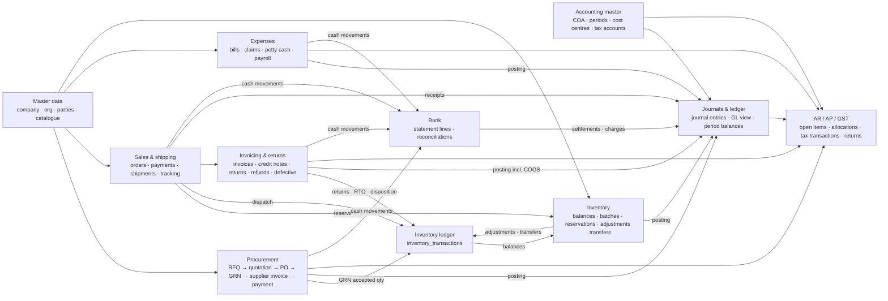

**Reading the overview:** master data feeds every operational module. Every quantity change goes through the single inventory ledger (D28/D33). Every financially relevant event posts exactly one journal (D50). The AR/AP and GST subledgers are built from documents and their journals, and reconcile to the GL control accounts (1E §7).

---

## 3. Company, Organisation & Locations

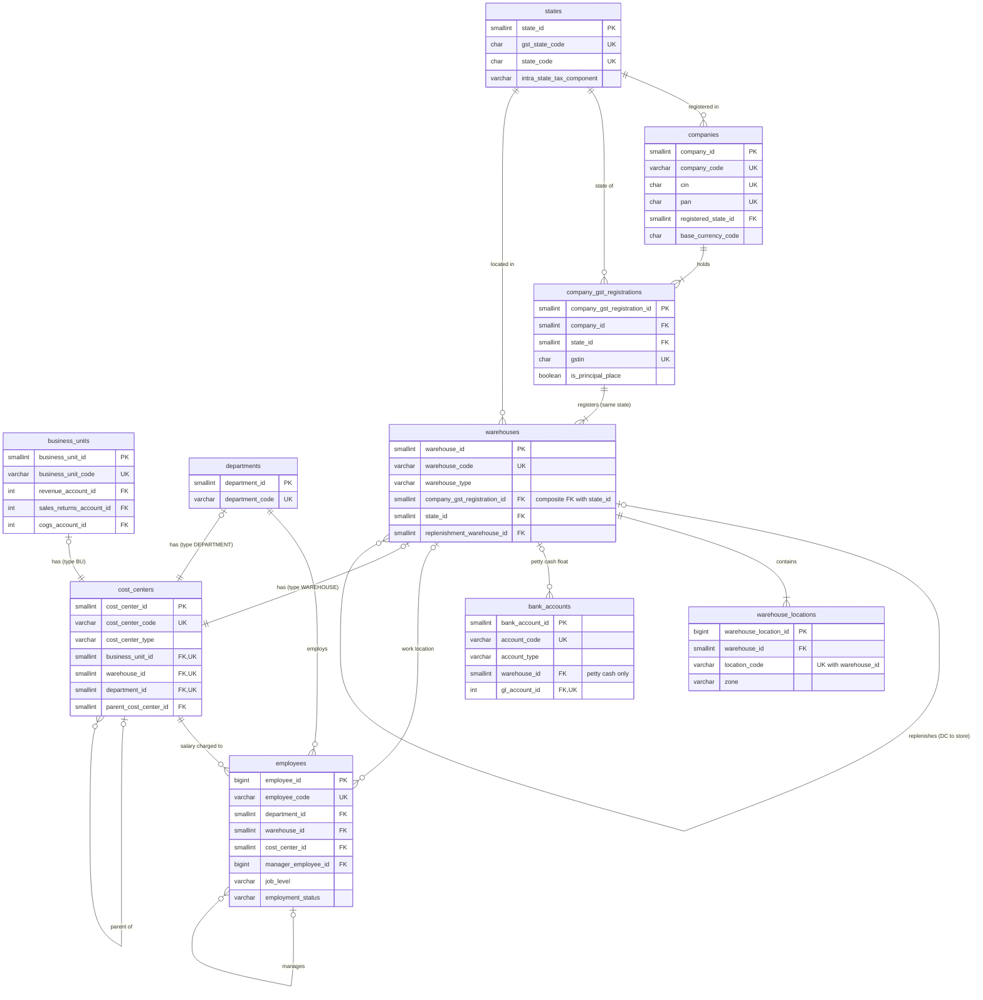

---

## 4. Parties, Catalogue & Commercial Reference

```mermaid
erDiagram
    customers {
        bigint customer_id PK
        varchar customer_code UK
        varchar customer_type
        char gstin UK
        smallint payment_term_id FK
        bigint sales_employee_id FK
        smallint acquisition_marketing_channel_id FK
        bigint acquisition_marketing_campaign_id FK
    }
    customer_addresses {
        bigint customer_address_id PK
        bigint customer_id FK
        smallint state_id FK
        bigint previous_customer_address_id FK, UK
        bigint default_billing_key UK "generated"
        bigint default_shipping_key UK "generated"
    }
    suppliers {
        bigint supplier_id PK
        varchar supplier_code UK
        varchar supplier_type
        char gstin UK
        smallint payment_term_id FK
        smallint default_expense_category_id FK
    }
    supplier_addresses {
        bigint supplier_address_id PK
        bigint supplier_id FK
        smallint state_id FK
        bigint previous_supplier_address_id FK, UK
        varchar default_key UK "generated"
    }
    supplier_products {
        bigint supplier_product_id PK
        bigint supplier_id FK "UK with product_id"
        bigint product_id FK
        decimal reference_unit_cost
        bigint preferred_key UK "generated"
    }
    product_categories {
        int product_category_id PK
        varchar category_code UK
        int parent_category_id FK "composite with business_unit_id"
        smallint business_unit_id FK
    }
    product_brands {
        int product_brand_id PK
        varchar brand_code UK
    }
    product_units_of_measure {
        smallint unit_of_measure_id PK
        varchar uom_code UK
    }
    products {
        bigint product_id PK
        varchar sku UK
        smallint business_unit_id FK
        int product_category_id FK "composite with business_unit_id"
        int product_brand_id FK
        smallint base_unit_of_measure_id FK
        varchar hsn_code
        decimal list_price
    }
    product_tax_rates {
        bigint product_tax_rate_id PK
        bigint product_id FK "UK with effective_from"
        decimal gst_rate
        date effective_from
        date effective_to
        bigint current_key UK "generated"
    }
    payment_terms {
        smallint payment_term_id PK
        varchar term_code UK
    }
    payment_methods {
        smallint payment_method_id PK
        varchar method_code UK
    }
    shipping_carriers {
        smallint shipping_carrier_id PK
        varchar carrier_code UK
        bigint supplier_id FK, UK
    }
    expense_categories {
        smallint expense_category_id PK
        varchar category_code UK
        int gl_account_id FK
    }
    sales_channels {
        smallint sales_channel_id PK
        varchar channel_code UK
    }
    marketing_channels {
        smallint marketing_channel_id PK
        varchar channel_code UK
    }
    marketing_campaigns {
        bigint marketing_campaign_id PK
        varchar campaign_code UK
        smallint marketing_channel_id FK
        smallint business_unit_id FK
        bigint owner_employee_id FK
    }

    customers ||--|{ customer_addresses : "has"
    customer_addresses |o--o| customer_addresses : "replaces (version)"
    states ||--o{ customer_addresses : "in"
    payment_terms ||--o{ customers : "default terms"
    employees |o--o{ customers : "account manager"
    marketing_channels ||--o{ customers : "acquired via (first touch)"
    marketing_campaigns |o--o{ customers : "acquired by"
    suppliers ||--|{ supplier_addresses : "has"
    supplier_addresses |o--o| supplier_addresses : "replaces (version)"
    states ||--o{ supplier_addresses : "in"
    payment_terms ||--o{ suppliers : "default terms"
    expense_categories |o--o{ suppliers : "default category"
    suppliers ||--o{ supplier_products : "approved for"
    products ||--o{ supplier_products : "supplied by"
    suppliers |o--o| shipping_carriers : "bills freight as"
    business_units ||--o{ product_categories : "owns"
    product_categories |o--o{ product_categories : "parent of"
    product_categories ||--o{ products : "classifies (leaf)"
    business_units ||--o{ products : "owns"
    product_brands ||--o{ products : "brands"
    product_units_of_measure ||--o{ products : "base UoM"
    products ||--|{ product_tax_rates : "GST rate history"
    marketing_channels ||--o{ marketing_campaigns : "runs on"
    business_units |o--o{ marketing_campaigns : "targets"
    employees ||--o{ marketing_campaigns : "owns"
```

`sales_channels` and `payment_methods` have no FKs of their own; they're referenced by orders, payments and refunds (§9, §10).

---

## 5. Accounting Master

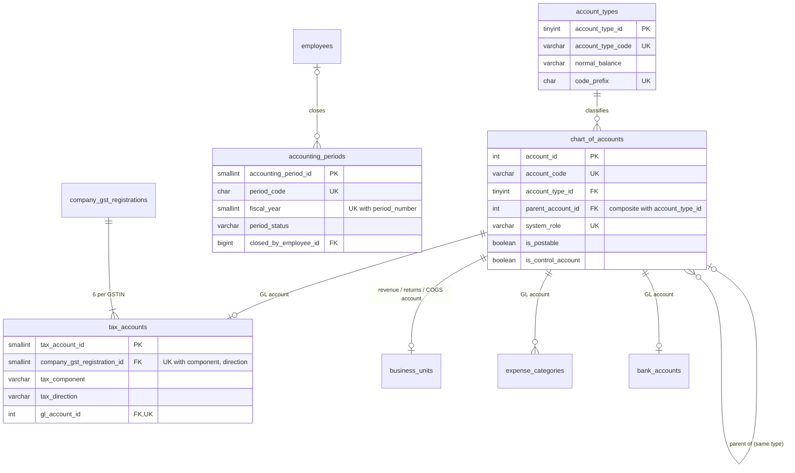

`business_units` has three separate FKs to `chart_of_accounts` (revenue, sales returns, COGS), drawn as one link. Cost centres are in §3.

---

## 6. Procurement

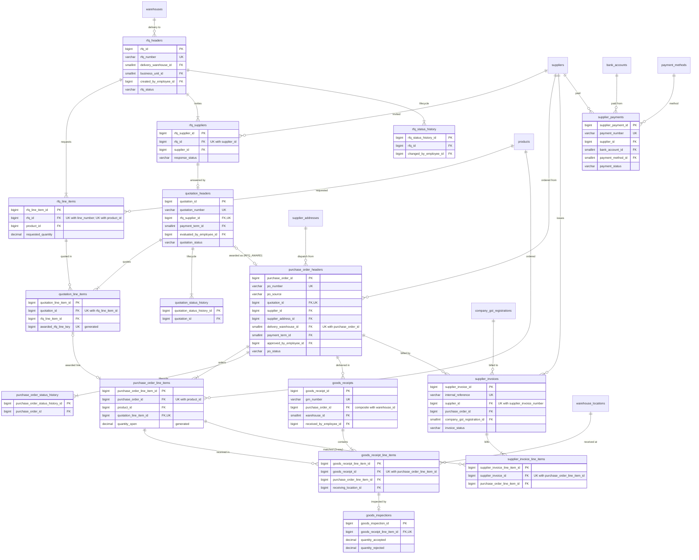

Supplier payments are applied to invoices through `supplier_payment_allocations` (§14).

---

## 7. Inventory Documents and Balances

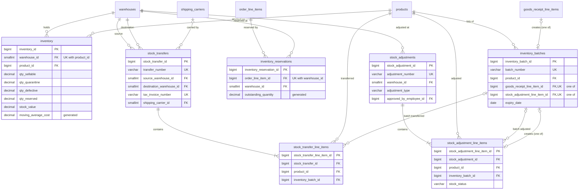

---

## 8. Inventory Ledger: Movement Sources

`inventory_transactions` is the only movement ledger. Each row has **exactly one** source document FK (D28), and the source must match `transaction_type` (1C §5.0, 1D D41).

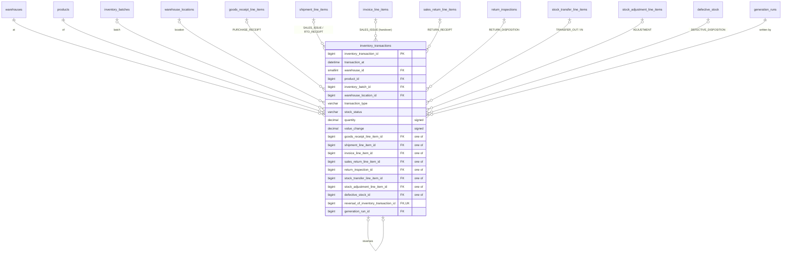

Balances in `inventory` (§7) always equal the ledger summed per warehouse × product × status (V-IN-01).

---

## 9. Sales & Shipping

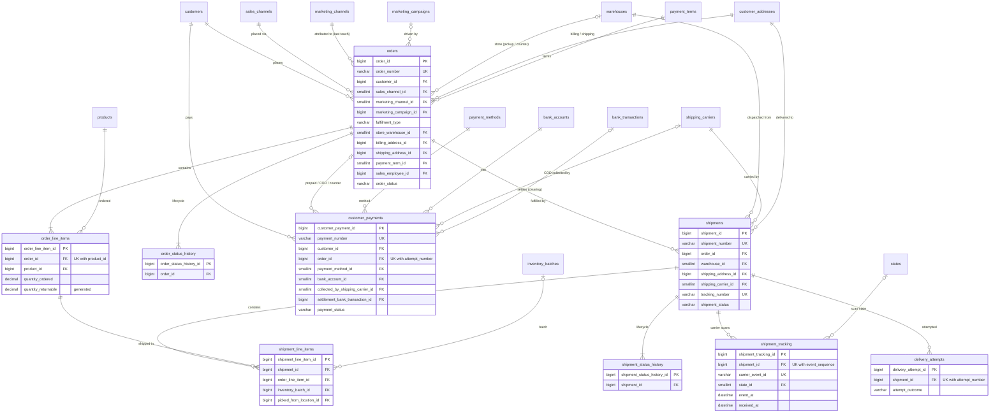

---

## 10. Invoicing, Returns & Defective Stock

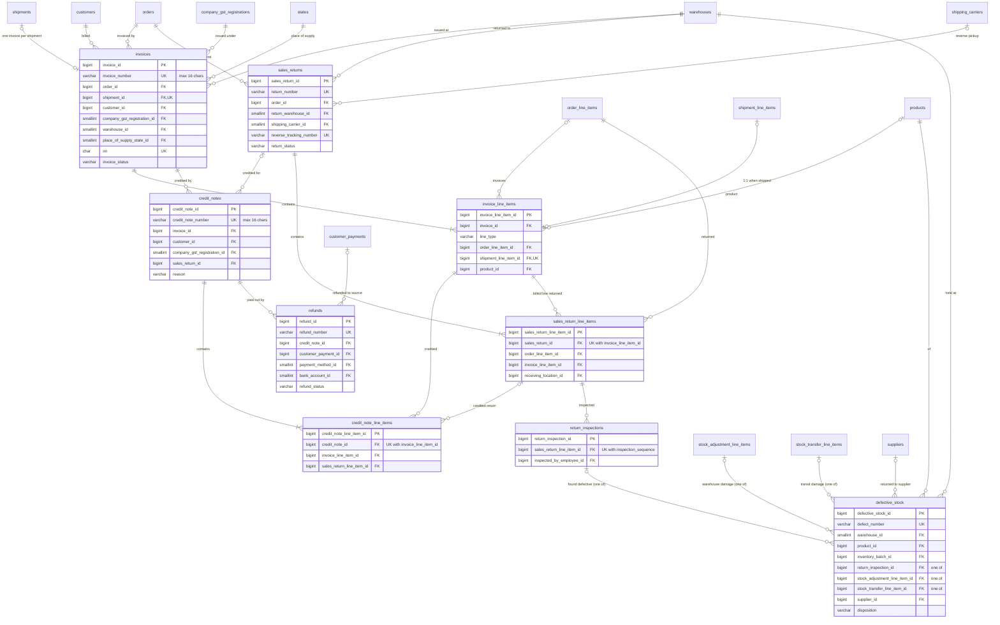

---

## 11. Expenses

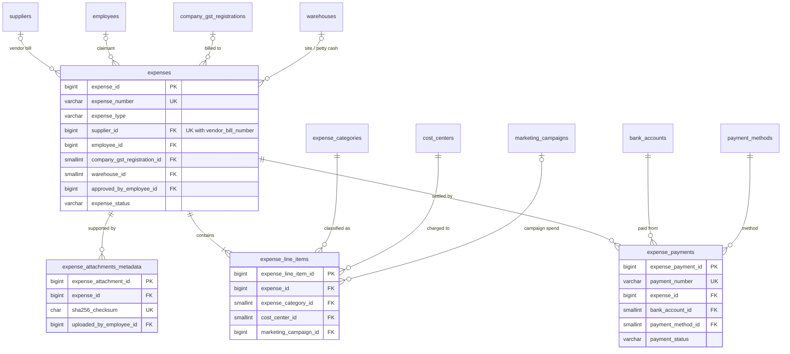

---

## 12. Journals and Ledger

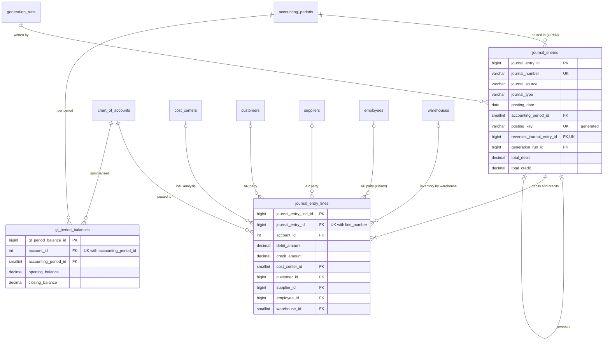

`v_general_ledger` (view) = `journal_entry_lines` ⋈ `journal_entries` ⋈ `accounting_periods` ⋈ `chart_of_accounts` ⋈ `account_types`, with a running balance per account (1E §3).

### 12.1 Journal sources (one journal per event, D50)

Each journal has **at most one** of these 16 source FKs; OPENING, RECURRING and MANUAL journals have none. Posting rules are in 1E §6.

```mermaid
erDiagram
    goods_receipts |o--o{ journal_entries : "GOODS_RECEIPT"
    supplier_invoices |o--o{ journal_entries : "SUPPLIER_INVOICE"
    supplier_payments |o--o{ journal_entries : "SUPPLIER_PAYMENT"
    invoices |o--o{ journal_entries : "SALES_INVOICE incl. COGS"
    credit_notes |o--o{ journal_entries : "CREDIT_NOTE"
    customer_payments |o--o{ journal_entries : "CUSTOMER_PAYMENT"
    refunds |o--o{ journal_entries : "REFUND"
    sales_returns |o--o{ journal_entries : "SALES_RETURN_RECEIPT"
    shipments |o--o{ journal_entries : "RTO_RECEIPT"
    stock_adjustments |o--o{ journal_entries : "STOCK_ADJUSTMENT"
    stock_transfers |o--o{ journal_entries : "TRANSFER_DISPATCH / RECEIPT"
    defective_stock |o--o{ journal_entries : "DEFECTIVE_DISPOSITION"
    expenses |o--o{ journal_entries : "EXPENSE"
    expense_payments |o--o{ journal_entries : "EXPENSE_PAYMENT"
    bank_transactions |o--o{ journal_entries : "BANK_SETTLEMENT / CHARGES"
    gst_returns |o--o{ journal_entries : "GST_SETTLEMENT"
```

---

## 13. Bank

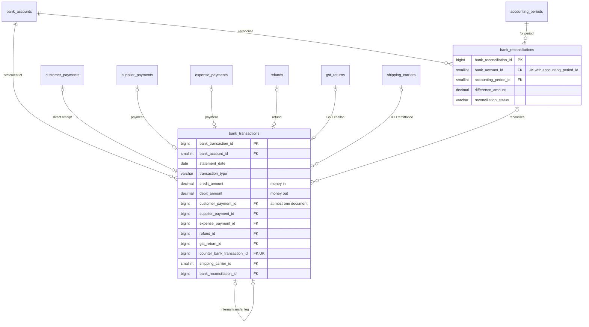

---

## 14. Receivables, Payables & Tax

```mermaid
erDiagram
    accounts_receivable {
        bigint accounts_receivable_id PK
        bigint customer_id FK
        varchar item_type
        bigint invoice_id FK, UK "one of"
        bigint credit_note_id FK, UK "one of"
        bigint customer_payment_id FK, UK "one of"
        bigint refund_id FK, UK "one of"
        decimal open_amount "signed"
        bigint journal_entry_id FK
    }
    customer_payment_allocations {
        bigint customer_payment_allocation_id PK
        bigint customer_payment_id FK "credit side, one of"
        bigint credit_note_id FK "credit side, one of"
        bigint invoice_id FK "debit side, one of"
        bigint refund_id FK "debit side, one of"
        decimal allocated_amount
    }
    accounts_payable {
        bigint accounts_payable_id PK
        bigint supplier_id FK "payee, one of"
        bigint employee_id FK "payee, one of"
        varchar item_type
        bigint supplier_invoice_id FK, UK "one of"
        bigint expense_id FK, UK "one of"
        bigint supplier_payment_id FK, UK "one of"
        decimal open_amount "signed"
        bigint journal_entry_id FK
    }
    supplier_payment_allocations {
        bigint supplier_payment_allocation_id PK
        bigint supplier_payment_id FK "UK with supplier_invoice_id"
        bigint supplier_invoice_id FK
        decimal allocated_amount
    }
    tax_transactions {
        bigint tax_transaction_id PK
        smallint company_gst_registration_id FK
        varchar tax_direction
        bigint invoice_line_item_id FK "one of"
        bigint credit_note_line_item_id FK "one of"
        bigint supplier_invoice_line_item_id FK "one of"
        bigint expense_line_item_id FK "one of"
        bigint stock_transfer_line_item_id FK "one of"
        bigint customer_id FK
        bigint supplier_id FK
        smallint place_of_supply_state_id FK
        char return_period "generated"
        bigint gst_return_id FK
    }
    gst_returns {
        bigint gst_return_id PK
        smallint company_gst_registration_id FK "UK with type, period"
        varchar return_type
        char return_period
        smallint bank_account_id FK
        varchar arn UK
    }
    gst_return_line_items {
        bigint gst_return_line_item_id PK
        bigint gst_return_id FK "UK with line_number"
        varchar section_code
        smallint place_of_supply_state_id FK
    }

    customers ||--o{ accounts_receivable : "owes"
    invoices |o--o| accounts_receivable : "open item"
    credit_notes |o--o| accounts_receivable : "open item"
    customer_payments |o--o| accounts_receivable : "open item"
    refunds |o--o| accounts_receivable : "open item"
    journal_entries ||--o| accounts_receivable : "posted by"
    customer_payments |o--o{ customer_payment_allocations : "applied"
    credit_notes |o--o{ customer_payment_allocations : "applied"
    invoices |o--o{ customer_payment_allocations : "settled"
    refunds |o--o{ customer_payment_allocations : "settled"
    suppliers |o--o{ accounts_payable : "owed"
    employees |o--o{ accounts_payable : "owed (claims)"
    supplier_invoices |o--o| accounts_payable : "open item"
    expenses |o--o| accounts_payable : "open item"
    supplier_payments |o--o| accounts_payable : "open item"
    journal_entries ||--o| accounts_payable : "posted by"
    supplier_payments ||--o{ supplier_payment_allocations : "applied"
    supplier_invoices ||--o{ supplier_payment_allocations : "settled"
    company_gst_registrations ||--o{ tax_transactions : "our GSTIN"
    invoice_line_items |o--o| tax_transactions : "output"
    credit_note_line_items |o--o| tax_transactions : "output (negative)"
    supplier_invoice_line_items |o--o| tax_transactions : "input"
    expense_line_items |o--o| tax_transactions : "input"
    stock_transfer_line_items |o--o{ tax_transactions : "output + input"
    customers |o--o{ tax_transactions : "buyer"
    suppliers |o--o{ tax_transactions : "seller"
    states ||--o{ tax_transactions : "place of supply"
    gst_returns |o--o{ tax_transactions : "reported in"
    company_gst_registrations ||--o{ gst_returns : "files"
    bank_accounts |o--o{ gst_returns : "paid from"
    gst_returns ||--|{ gst_return_line_items : "sections"
    states |o--o{ gst_return_line_items : "by state"
```

---

## 15. System and Generation Control (keys only; columns in 1G)

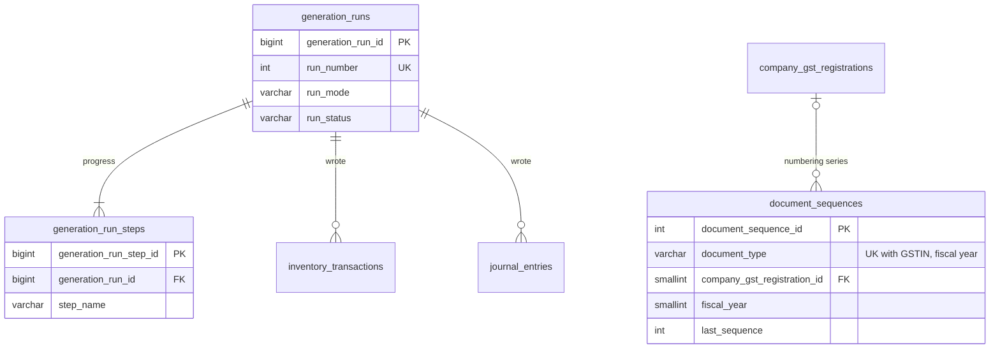

---

## 16. End-to-End Traceability (master prompt §15A)

The two required chains as a path through the diagrams. Every arrow is a real FK, walkable in both directions.

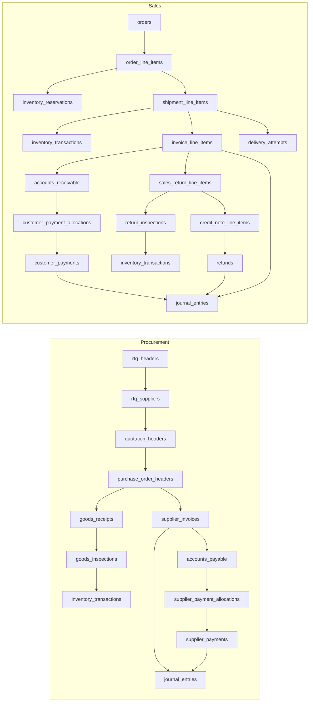

---

## 17. Diagram Validation

All **16** Mermaid diagrams in this document were parsed with the Mermaid library (v11.4.1, under Node.js with jsdom) on 2026-11-08: 16 parsed, 0 failed. To show the check really detects errors, two deliberately broken diagrams were run through the same script and both were rejected. Repeat the check whenever a diagram changes. A reusable `validate-docs` command can be added in Phase 6 (documentation).

---

## 18. What Comes Next

Part 1G: historical and continuous generation architecture, workspaces and re-runs (A2), the system tables (`document_sequences`, `generation_runs`, `generation_run_steps`), the DuckDB loader (full / incremental / watermarks), CDC and anomaly simulation architecture. Resolves Q4 and Q5.
