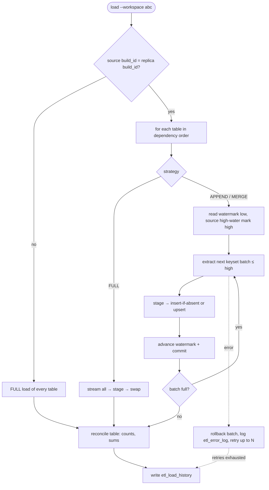
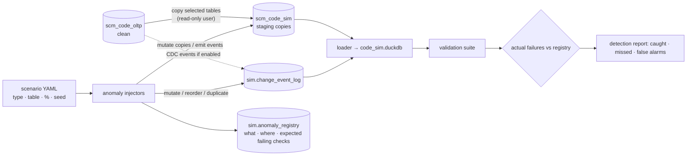

# Phase 1 – Part 1G: Generation, Workspaces, DuckDB Loader, CDC and Anomaly Architecture

**Project:** Synthetic Supply Chain OLTP Database & Data Engineering Practice Platform
**Status:** Accepted (D9). Baseline for Phases 2–7
**Last updated:** 2026-11-08
**Builds on:** Parts 1A–1F (D1–D63). Workspaces and re-run actions: 1A Addendum A2 (D13, D14)

---

## 0. Scope

This part answers the master prompt's remaining Phase 1 items (§13, §17 items 12–14):

1. **Historical and continuous generation:** the simulated clock, the daily engine, determinism, restarts (§2–§3)
2. **Workspaces and re-runs:** the registry and the Continue / Rebuild / New actions in practice (§4)
3. **System tables:** `document_sequences`, `generation_runs`, `generation_run_steps`, plus `scm_control.workspaces` (§5). With these, **all 92 tables are designed**
4. **DuckDB loader:** full, incremental and table-level loads; watermarks; metadata; reconciliation (§6–§7)
5. **CDC and anomaly simulation:** how clean data is protected and imperfect data is introduced separately (§8–§9)
6. **Code structure and CLI** that implement this design (§10–§11)

It resolves **Q4** (simulated clock vs watermarks) and **Q5** (load strategy per table).

---

## 1. Decisions Made in This Part

| # | Decision | Choice | Why |
|---|---|---|---|
| D64 | Unit of work | The engine simulates **one business day at a time**, and each day is **one MySQL transaction** covering all modules. A failure rolls back only the day in progress; every committed day is complete and consistent. **Refines A2:** "a failed run is rolled back" needs no deletes, because the database transaction does it | Clean data is guaranteed after any crash (no half-posted invoices or orphan lines). A Medium day is a few thousand rows and a Large day tens of thousands, so day-sized transactions are comfortable for InnoDB |
| D65 | Randomness | Every random choice draws from a stream keyed by **(workspace base seed, simulated date, stream name)**, e.g. `(42, 2025-10-21, "orders")`. **Refines A2's per-run seed** | The same history comes out however the days are split across runs: one 2-year run, or 730 one-day Continue runs, or a crash and resume, all give **identical data**. Per-run seeds would make the data depend on how often you ran the tool |
| D66 | Engine model | A **daily state-machine simulation**. The state lives in the OLTP documents themselves (statuses, planned and due dates). Each day the engine (1) creates new events from demand and replenishment models, then (2) advances open documents whose next step is due, drawing outcomes (delay, failure, rejection) on the day they happen. There's **no hidden event queue** | Continue mode needs nothing but the database to resume. Every pending step is visible in the data, which also makes the data easier to explain |
| D67 | **Q4: simulated clock vs watermarks** | `created_at` / `updated_at` are the **simulated time at which the row was recorded**, which only moves forward (confirms D21: no `ON UPDATE CURRENT_TIMESTAMP`). Business dates may lie in the past (late invoices, back-dated events), but audit timestamps never do. After each committed day, the run sets `generation_runs.committed_through` (the end of that day). The loader never reads past the latest `committed_through`, and its watermark is the pair (`updated_at`, primary key) | Watermark extraction is only safe if no row can later appear with a timestamp below the watermark. Monotonic recording time plus a committed high-water mark guarantees that, even while generation is running. Using the pair resolves ties at the same microsecond |
| D68 | How far Continue goes | By default, Continue advances the clock to **today** (real date). `--days N` simulates N days; going past today requires `--allow-future` | Running Continue each morning gives "yesterday's business", a realistic daily-batch rhythm. Future business dates stay an explicit opt-in |
| D69 | **Q5: load strategies** | Each table is configured with one of three strategies (§7): **FULL** (small reference tables), **APPEND** (insert-only tables, `created_at` watermark, insert-if-absent), **MERGE** (mutable tables, `updated_at` watermark, upsert by PK). One generic loader reads table structure from `information_schema`; there's no per-table code | Matches each table's real change behaviour (1B–1E). Append is cheaper, merge is required for mutable tables, and full reload keeps tiny tables trivial |
| D70 | DuckDB layout | One DuckDB file per workspace **per source**: `data/duckdb/<code>.duckdb` (replica of clean `_oltp`) and `data/duckdb/<code>_sim.duckdb` (replica of `_sim`). Each file has schemas `raw` (replica tables, same names) and `etl_meta` (load metadata). Later, dbt adds `staging` / `marts` | Practice on imperfect data can never pollute the clean replica. Downstream dbt projects get a stable `raw` layer |
| D71 | Extraction mechanics | Python streams from MySQL (PyMySQL server-side cursor, keyset-paginated batches) into Apache Arrow, then into DuckDB. DuckDB's `mysql` extension is noted as an optional optimisation for later | Writing extraction in Python is the learning goal (master prompt §9), and keeps batching, retries and failure injection under our control |
| D72 | CDC source | When `cdc.enabled` is set, the engine writes an **application-level change event** (before / after image) for every insert, update and soft delete into `scm_<code>_sim.change_event_log`, in the same transaction. MySQL binlog-based capture is an optional advanced exercise in Phase 7 | Deterministic, needs no MySQL replication privileges or extra services, and keeps "business events" (documents) clearly separate from "source change events" (the log), as the master prompt asks (§15C) |
| D73 | Anomaly isolation | Anomaly tooling connects as a separate MySQL user `scm_anomaly` with **read-only access to `scm_%_oltp`** and write access only to `scm_%_sim`. Every injected anomaly is recorded in an anomaly registry together with the validation checks it is expected to fail | The database itself makes it impossible for anomaly code to modify clean data. The registry makes anomalies identifiable for detection and remediation exercises (§15D) |
| D74 | System-table timestamps | `generation_runs`, `generation_run_steps` and `scm_control.workspaces` use **wall-clock** time for their own timing columns (`started_at`, `finished_at`, …) and the loader FULL-loads them. They also store simulated dates where relevant (`sim_start_date`, `committed_through`) | They describe the tool's operation, not the business. Mixing the two timelines in one column would confuse both |
| D75 | Gap-free numbering | `document_sequences` rows are incremented inside the day transaction (D64). A rolled-back day releases its numbers, so committed tax-invoice numbers are consecutive with no gaps | GST requires consecutive invoice serials per GSTIN per FY |
| D76 | Validation gate | Every generation run ends with the full validation suite (1B–1E rules). The result is stored on `generation_runs`. If a clean run fails validation, the workspace is flagged; Continue and loading refuse to proceed without `--force` | The clean schema is guaranteed to pass its checks (master prompt §14). A failure means a generator bug, and the gate stops it spreading downstream |
| D77 | Time zone | All timestamps are naive `DATETIME` in **Asia/Kolkata (IST)**, the company's operating time zone. The loader carries them into DuckDB as `TIMESTAMP` (no time zone), unchanged | A single-country business. One documented convention avoids mixed-zone bugs. Time-zone conversion can be practised in dbt |

---

## 2. Generation Engine

### 2.1 Run phases

```
create workspace ─► create schemas (DDL) ─► load seed data ─► generate setup + master data (day 0)
   ─► opening balances: opening journal (P01) + opening stock (P02) on history start date
   ─► daily loop: for D in [start .. end]: simulate day D, commit, update committed_through
   ─► validation suite ─► finalise run (status, counts, report)
```

**Continue** skips straight to the daily loop, starting from the last run's `committed_through` + 1 day. **Rebuild** drops and recreates the schemas, then starts from the top with a new build id (A2).

### 2.2 One simulated day: fixed step order

The same order every day, so timestamps within a day are consistent with cause and effect. Each step gets its own RNG stream (D65).

| # | Step | What happens (examples) |
|---|---|---|
| 1 | Calendar | Is it a working day (Sunday and national holidays: warehouses closed, B2B quiet), month start/end flags, festival windows from the pack calendar |
| 2 | Periods | Open the new month's period on the 1st; close the previous month on the configured working day (1B) after the period-end tasks below are done |
| 3 | Master data changes | New customers (acquisition curve), address versions, price revisions, supplier rating updates, hires and exits, new campaigns, product launches and discontinuations, scheduled GST rate changes |
| 4 | Procurement | Replenishment check → RFQs or direct POs; quotations arriving; evaluations and awards; PO approvals and sending; deliveries due → GRNs + dock inspection (stock in); supplier invoices received → match → approval (AP); weekly payment run |
| 5 | Demand | New orders by hour (B2C peaks evenings and weekends, B2B on weekday business hours); prepaid payment attempts; credit checks and holds; cancellations |
| 6 | Fulfilment | Reservations and backorder release; picking → packing → dispatch (invoice + stock issue + COGS); carrier progress and tracking events; delivery attempts; deliveries (COD collection); RTOs |
| 7 | Collections | B2B payments by behaviour profile; allocations; cheque clearing; chargebacks |
| 8 | Returns | Requests on delivered lines; approvals; pickups; receipts; inspections; defective register; credit notes; refunds |
| 9 | Inventory housekeeping | Store replenishment and DC rebalancing transfers; transfer receipts; cycle counts; expiry sweep; defective dispositions |
| 10 | Expenses | Recurring bills due, usage bills (freight, commission), ad hoc expenses, petty cash, approvals, expense payments; payroll on the last day of the month |
| 11 | Bank | Gateway settlements, COD remittances, bank charges, interest, petty-cash top-ups |
| 12 | Period-end tasks (on their dates) | Depreciation (month end); GSTR-1 (by the 11th) and GSTR-3B + payment (by the 20th); bank reconciliations; `gl_period_balances` rebuild at close |
| 13 | Commit | Commit the day; set `committed_through`; update progress (`generation_run_steps`) |

Within a day, each event gets a timestamp in its plausible hours (e.g. dispatches 10:00–19:00, carrier scans around the clock). Step order guarantees that cause comes before effect (an invoice can't be timestamped before its dispatch).

### 2.3 Behaviour models (configured, not hardcoded)

All rates and curves live in YAML (`config/settings.yaml`, industry packs, `config/scenarios.yaml`). The engine contains the mechanisms; the configuration holds the numbers.

| Model | Drives |
|---|---|
| Demand | Base orders/day × monthly seasonality (pack) × weekday/hour profile × trend × campaign uplift × festival spikes |
| Customer behaviour | Repeat-purchase probability (B2C), Pareto order share (B2B), payment profile (on-time / late / chronic), return propensity |
| Supplier behaviour | Response rate, price variation, lead-time reliability by rating, partial-delivery and rejection probability |
| Logistics | Transit time by distance (warehouse coordinates → destination region) and carrier, failure and RTO probability (COD higher) |
| Scenario mix | Master prompt §6 scenarios as configurable rates: cancellations, failed payments, partial payments, overdue invoices, partial/full returns, refunds pending, defective goods, rejected quotations, partial and delayed receipts, stock shortages, adjustments, late supplier payments, irregular expenses |

The defaults are chosen so that no single outcome is unrealistically common (§6 of the master prompt). The Plan preview screen (Phase 5) shows the expected counts before a run.

### 2.4 Determinism, IDs and idempotency

- **Same config + same base seed ⇒ identical database**, byte for byte in business columns (D65). IDs are assigned by the engine in insert order (D20), so they match too. A Phase 3 test proves it by building twice and comparing table checksums.
- **Restart safety:** document numbers come from `document_sequences` inside the day transaction (D75). Journals can't be posted twice (`posting_key`, D50). Every source FK carries a UNIQUE where an event may happen only once (e.g. `goods_inspections.goods_receipt_line_item_id`). Re-running a day that was already committed is impossible, because Continue always starts after `committed_through`.
- **Cancel:** the UI or CLI sets `cancel_requested`. The engine finishes and commits the current day, then stops with status CANCELLED. The data stays consistent and the next Continue resumes from there.
- **Single writer:** a run takes a MySQL named lock (`GET_LOCK('scm_<code>')`). A second run on the same workspace fails immediately instead of interleaving.

### 2.5 Performance approach

Master data and all open documents for the current day are cached in memory. Each step builds rows in memory and writes them with multi-row `executemany` batches (configurable batch size, default 1,000 rows per statement). Indexes stay in place: day-sized transactions keep the cost acceptable, and the schema is validated continuously. Phase 3 measures throughput (rows/s) per table and records it in `generation_run_steps`, which feeds the Plan preview's time estimate (A1 §8.4). Target: Medium preset (~2 years, ~2.5M rows) in under 15 minutes on a laptop. This target is checked in Phase 3, not assumed.

---

## 3. Historical vs Continuous Generation

| Aspect | Initial historical (first run / Rebuild) | Continuous (Continue) |
|---|---|---|
| Clock range | Configured start (1–3 years back) → end (default today) | Last `committed_through` + 1 day → today (or `--days N`, D68) |
| Master data | Created on day 0, then evolves daily | Evolves daily (same step 3) |
| Opening position | Opening journal + opening stock on the start date | None, continues from existing state |
| Open documents at the end | Naturally present: orders in transit, unpaid and overdue invoices, open POs, pending refunds (master prompt §15B "completed and outstanding transactions") | Progress day by day: shipped → delivered, invoices paid or aging, POs received |
| Config changes allowed | Any (Rebuild) | Volumes and scenario rates only; identity and industries are fixed (A2) |
| Effect on the DuckDB replica | Build id changes → next load is FULL | Same build → next load is incremental |

Because history comes from the same daily engine as Continue, there's no difference in data quality or realism between "historical" and "new" data. That's why the master prompt's two modes can share one engine.

---

## 4. Workspaces and Re-runs (A2 in practice)

- **Registry:** `scm_control.workspaces` (§5.4). One row per company workspace. CLI `--workspace <code>`; the UI picks from the list.
- **Create:** validate the code (`^[a-z][a-z0-9]{1,9}$`) → create `scm_<code>_oltp` and `scm_<code>_sim` → apply DDL → register → first run (historical).
- **Continue:** allowed only if status is READY and the last run passed validation (D76).
- **Rebuild:** requires typed confirmation of the workspace code. Steps: set status REBUILDING → drop both schemas → recreate → new `build_id` → historical run. The DuckDB replica detects the new build id and full-reloads (A2).
- **Delete workspace:** drops the schemas, removes the DuckDB files, marks the registry row ARCHIVED. Same confirmation as Rebuild.
- **Privileges (D8, D73):**
  - `scm_app` has all privileges on `scm\_%` (including `scm_control`).
  - `scm_anomaly` has `SELECT` on `scm\_%\_oltp` and full privileges on `scm\_%\_sim` only.
  - The loader can use a read-only user `scm_reader` (`SELECT` on `scm\_%`) as a good-practice option.

---

## 5. System Tables

These live in each workspace's `_oltp` schema, except `workspaces` (in `scm_control`). The standard audit columns apply. Timing columns are wall-clock (D74).

#### 5.1 `document_sequences`

| Column | Type | NN | Notes |
|---|---|---|---|
| `document_sequence_id` | `INT UNSIGNED` | ✓ | PK |
| `document_type` | `VARCHAR(20)` | ✓ | `PO`, `GRN`, `TAX_INVOICE`, `CREDIT_NOTE`, `JV`, … (1C §2.1, D38) |
| `company_gst_registration_id` | `SMALLINT UNSIGNED` | | FK. NULL for company-wide series (e.g. `JV`) |
| `fiscal_year` | `SMALLINT UNSIGNED` | ✓ | FY start year |
| `last_sequence` | `INT UNSIGNED` | ✓ | Default 0. Last number issued |
| `series_key` | generated `SMALLINT UNSIGNED` | | `COALESCE(company_gst_registration_id, 0)` STORED |

- **Keys:** UNIQUE `(document_type, series_key, fiscal_year)`. The generated key is needed because MySQL treats NULLs as distinct in UNIQUE indexes, so without it the company-wide series could be duplicated.
- **Use:** `SELECT … FOR UPDATE` → increment → format the number, inside the day transaction (D75). The engine reserves numbers for a whole day's batch in one update.
- **Rule:** `last_sequence` = the highest number issued for that series (V-SY-01).

#### 5.2 `generation_runs`

| Column | Type | NN | Notes |
|---|---|---|---|
| `generation_run_id` | `BIGINT UNSIGNED` | ✓ | PK |
| `run_number` | `INT UNSIGNED` | ✓ | UNIQUE. 1, 2, 3 … within the build |
| `build_id` | `CHAR(36)` | ✓ | UUID of the workspace build (A2) |
| `run_mode` | `VARCHAR(20)` | ✓ | `HISTORICAL` / `CONTINUE` |
| `triggered_by` | `VARCHAR(10)` | ✓ | `CLI` / `UI` |
| `base_seed` | `BIGINT UNSIGNED` | ✓ | Workspace seed (D65) |
| `config_snapshot` | `JSON` | ✓ | Full effective configuration used |
| `config_hash` | `CHAR(64)` | ✓ | SHA-256 of the snapshot |
| `app_version` | `VARCHAR(20)` | ✓ | Package version, so behaviour changes can be traced |
| `sim_start_date` | `DATE` | ✓ | First simulated day |
| `sim_end_date` | `DATE` | ✓ | Planned last day |
| `committed_through` | `DATETIME(6)` | | Simulated end of the last committed day (Q4 high-water mark, D67) |
| `run_status` | `VARCHAR(20)` | ✓ | `PENDING` / `RUNNING` / `COMPLETED` / `FAILED` / `CANCELLED` |
| `cancel_requested` | `BOOLEAN` | ✓ | Default FALSE |
| `process_id` | `INT UNSIGNED` | | OS process of the background job (UI) |
| `started_at` / `finished_at` | `DATETIME(6)` | | Wall clock |
| `rows_written` | `BIGINT UNSIGNED` | ✓ | Default 0 |
| `error_message` | `TEXT` | | |
| `validation_status` | `VARCHAR(20)` | ✓ | `NOT_RUN` / `PASSED` / `FAILED` |
| `validation_report_path` | `VARCHAR(300)` | | `data/reports/<code>/run_<n>_validation.json` |

- **Constraints:** CHECK lists; CHECK `sim_end_date >= sim_start_date`; CHECK `run_status <> 'RUNNING' OR started_at IS NOT NULL`; CHECK `(run_status IN ('COMPLETED','FAILED','CANCELLED')) = (finished_at IS NOT NULL)`; CHECK `run_status <> 'FAILED' OR error_message IS NOT NULL`.
- **Rules:** Runs within a build are contiguous: each run's `sim_start_date` = the previous run's last committed day + 1 (V-SY-02). At most one RUNNING run (also guarded by the named lock).
- **Referenced by:** `inventory_transactions.generation_run_id`, `journal_entries.generation_run_id`. Those two tables show which run wrote each movement and posting; a high-volume audit column on every table isn't needed.

#### 5.3 `generation_run_steps`

Progress and throughput per phase (A1 §8.4).

| Column | Type | NN | Notes |
|---|---|---|---|
| `generation_run_step_id` | `BIGINT UNSIGNED` | ✓ | PK |
| `generation_run_id` | `BIGINT UNSIGNED` | ✓ | FK |
| `step_name` | `VARCHAR(40)` | ✓ | `SCHEMA` / `SEED_DATA` / `MASTER_DATA` / `OPENING_BALANCES` / `DAILY_SIMULATION` / `VALIDATION` / `FINALISE` |
| `step_order` | `TINYINT UNSIGNED` | ✓ | |
| `step_status` | `VARCHAR(20)` | ✓ | `PENDING` / `RUNNING` / `COMPLETED` / `FAILED` / `SKIPPED` |
| `planned_units` | `BIGINT UNSIGNED` | | Days for `DAILY_SIMULATION`, rows otherwise |
| `completed_units` | `BIGINT UNSIGNED` | ✓ | Default 0 |
| `planned_rows` | `BIGINT UNSIGNED` | | From the Plan preview estimate |
| `generated_rows` | `BIGINT UNSIGNED` | ✓ | Default 0 |
| `current_sim_date` | `DATE` | | Daily loop position |
| `rows_per_second` | `DECIMAL(12,2)` | | Rolling throughput |
| `rows_by_table` | `JSON` | | `{"orders": 812, "invoices": 790, …}`, updated every N days |
| `started_at` / `finished_at` | `DATETIME(6)` | | Wall clock |

- **Keys:** UNIQUE `(generation_run_id, step_name)`.
- **Use:** The UI polls this table every few seconds. ETA = remaining units ÷ recent rate.

#### 5.4 `scm_control.workspaces` (platform registry, outside the 92)

| Column | Type | NN | Notes |
|---|---|---|---|
| `workspace_id` | `INT UNSIGNED` | ✓ | PK |
| `workspace_code` | `VARCHAR(10)` | ✓ | UNIQUE (`kaveri`, `abc`) |
| `company_name` | `VARCHAR(200)` | ✓ | |
| `industries` | `JSON` | ✓ | Industry pack codes |
| `oltp_schema` / `sim_schema` | `VARCHAR(64)` | ✓ | UNIQUE each |
| `duckdb_path` / `duckdb_sim_path` | `VARCHAR(300)` | ✓ | |
| `base_seed` | `BIGINT UNSIGNED` | ✓ | |
| `build_id` | `CHAR(36)` | ✓ | Changes on Rebuild |
| `config_snapshot` | `JSON` | ✓ | Identity-level config (company, industries, warehouses) |
| `workspace_status` | `VARCHAR(20)` | ✓ | `CREATING` / `READY` / `GENERATING` / `REBUILDING` / `NEEDS_ATTENTION` / `FAILED` / `ARCHIVED` |
| `last_committed_through` | `DATETIME(6)` | | Copy of the latest run's value, for listing |
| `created_at` / `updated_at` | `DATETIME(6)` | ✓ | Wall clock |

`NEEDS_ATTENTION` = the last run failed validation (D76).

---

## 6. DuckDB Loader Architecture

### 6.1 Principles (master prompt §9)

- MySQL is the source of truth; DuckDB is a replica (`raw` schema) plus load metadata (`etl_meta`).
- **One generic loader** driven by `config/loader/tables.yaml` (strategy per table, §7) and `information_schema` (columns, types, PK). There are no table-specific functions.
- **Idempotent:** any load can be re-run or retried without duplicates, because data and watermark are committed together.
- **Safe during generation:** reads never go past the source's committed high-water mark (D67).

### 6.2 Type mapping

| MySQL | DuckDB |
|---|---|
| `TINYINT/SMALLINT/INT/BIGINT UNSIGNED` | `UTINYINT/USMALLINT/UINTEGER/UBIGINT` |
| `TINYINT(1)` / `BOOLEAN` | `BOOLEAN` |
| `DECIMAL(p,s)` | `DECIMAL(p,s)` (same precision: no FLOAT anywhere) |
| `CHAR(n)` / `VARCHAR(n)` / `TEXT` | `VARCHAR` |
| `DATE` | `DATE` |
| `DATETIME(6)` | `TIMESTAMP` (µs precision, naive IST, D77) |
| `JSON` | `JSON` |
| Generated columns | Plain columns holding the source value |

Primary keys are recreated in DuckDB (needed for upserts). Foreign keys and CHECKs aren't: the replica doesn't enforce business rules, and the validation layer checks them instead.

### 6.3 Load types

| Type | When | How |
|---|---|---|
| **FULL** | First load; strategy FULL tables every run; source build id changed; `--full` | Stream all rows (up to the high-water mark for business tables) into `raw._stage_<table>` → in one DuckDB transaction: drop `raw.<table>`, rename the stage table, set the watermark to the max (`updated_at`, PK) loaded → readers never see a half-loaded table |
| **INCREMENTAL APPEND** | Insert-only tables | Extract `created_at` / PK window → `INSERT INTO raw.<t> SELECT … FROM stage WHERE pk NOT IN raw` (anti-join makes retries harmless) → advance the watermark, same transaction |
| **INCREMENTAL MERGE** | Mutable tables | Extract `updated_at` / PK window → `INSERT OR REPLACE INTO raw.<t>` (upsert by PK) → advance the watermark, same transaction. Counts inserted vs updated by checking which PKs already existed |
| **TABLE RELOAD** | `load --table <t> --full` | FULL for one table; other tables untouched |

### 6.4 Incremental window and batching (Q4 in the loader)

```
low  = etl_table_watermarks (last_ts, last_pk)            -- exclusive
high = MAX(generation_runs.committed_through)             -- inclusive; committed data only
batch query (keyset pagination, ordered):
  SELECT … FROM <t>
  WHERE (updated_at, pk) > (:last_ts, :last_pk) AND updated_at <= :high
  ORDER BY updated_at, pk
  LIMIT :batch_size
each batch: load into stage → merge → set watermark = last (updated_at, pk) of the batch → COMMIT
repeat until a batch returns fewer than batch_size rows
```

- **Why it's correct:** recording timestamps only increase (D67), and nothing at or before `high` can still be uncommitted. So no row can later appear "behind" the watermark. Using the (timestamp, PK) pair makes ties at the same microsecond safe. Committing each batch with its watermark means a crash mid-table resumes from the last good batch.
- **Updates during extraction:** a row updated after its batch was read gets a newer `updated_at` (≤ `high` only if already committed; otherwise picked up by the next load). It's never lost, and MERGE overwrites the older version.
- **Append safety net:** after each APPEND load, the loader checks the source for rows in that table with `updated_at > created_at` (there should be none). Any found are logged to `etl_error_log` as `STRATEGY_VIOLATION`, and the table is flagged for MERGE. A table misclassified as insert-only can't silently lose updates.
- **Build check:** if `scm_control.workspaces.build_id` ≠ the build id stored in DuckDB, incremental loading is refused and a FULL load of all tables is performed (A2).
- **Validation gate:** loading refuses a workspace in `NEEDS_ATTENTION` unless `--force` (D76).



### 6.5 Metadata tables (DuckDB `etl_meta`)

#### `etl_load_history`
One row per table per load.

| Column | Type | Notes |
|---|---|---|
| `load_id` | `UBIGINT` PK | |
| `load_batch_id` | `VARCHAR` | Groups all tables of one `load` command |
| `source_schema` / `source_table` / `target_table` | `VARCHAR` | |
| `load_type` | `VARCHAR` | `FULL` / `INCREMENTAL_APPEND` / `INCREMENTAL_MERGE` / `TABLE_RELOAD` |
| `source_build_id` | `VARCHAR` | |
| `watermark_from_ts` / `watermark_from_pk` | `TIMESTAMP` / `UBIGINT` | Exclusive low |
| `watermark_to_ts` / `watermark_to_pk` | `TIMESTAMP` / `UBIGINT` | Last loaded |
| `high_water_mark` | `TIMESTAMP` | Source committed bound used |
| `started_at` / `finished_at` | `TIMESTAMP` | Wall clock |
| `batches` | `UINTEGER` | |
| `rows_extracted` / `rows_inserted` / `rows_updated` / `rows_failed` | `UBIGINT` | |
| `load_status` | `VARCHAR` | `RUNNING` / `SUCCESS` / `FAILED` / `PARTIAL` (some batches committed before a failure) |
| `reconciliation_status` | `VARCHAR` | `PASSED` / `FAILED` / `SKIPPED` |
| `error_message` | `VARCHAR` | |

#### `etl_table_watermarks`
Current position per table.

| Column | Type | Notes |
|---|---|---|
| `source_table` | `VARCHAR` PK | |
| `strategy` | `VARCHAR` | From config |
| `watermark_column` | `VARCHAR` | `created_at` / `updated_at` / NULL for FULL |
| `last_watermark_ts` / `last_watermark_pk` | `TIMESTAMP` / `UBIGINT` | |
| `source_build_id` | `VARCHAR` | |
| `last_load_id` | `UBIGINT` | → `etl_load_history` |
| `last_success_at` | `TIMESTAMP` | |
| `target_row_count` | `UBIGINT` | After the last load |

#### `etl_error_log`

| Column | Type | Notes |
|---|---|---|
| `error_id` | `UBIGINT` PK | |
| `load_id` | `UBIGINT` | |
| `source_table` | `VARCHAR` | |
| `batch_number` | `UINTEGER` | |
| `error_stage` | `VARCHAR` | `EXTRACT` / `STAGE` / `MERGE` / `RECONCILE` |
| `error_type` | `VARCHAR` | `CONNECTION`, `TYPE_CONVERSION`, `DUPLICATE_KEY`, `STRATEGY_VIOLATION`, `RECONCILIATION_MISMATCH`, … |
| `error_message` | `VARCHAR` | |
| `record_key` | `VARCHAR` | PK value when row-level |
| `record_payload` | `JSON` | Offending row (row-level errors) |
| `occurred_at` | `TIMESTAMP` | |
| `retry_count` | `UTINYINT` | |

Row-level failures can't happen on clean data. In the sim replica (Phase 7), rows that fail conversion go to `etl_meta.quarantine` (`source_table`, `record_key`, `record_payload`, `reason`, `load_id`) and are counted in `rows_failed`; the batch continues.

### 6.6 Reconciliation after every load (master prompt §10 "MySQL versus DuckDB")

Per table, against the same high-water mark: (1) row count; (2) count of distinct PKs = row count (no duplicates); (3) sum of the main money column (e.g. `total_amount`, `debit_amount`) and of `quantity` columns; (4) max (`updated_at`, PK) equals the watermark. A mismatch sets `reconciliation_status = FAILED` and logs `RECONCILIATION_MISMATCH`, but doesn't roll back. The data stays, and the next load or a table reload fixes it.

### 6.7 Failure and recovery behaviour

| Failure | Behaviour |
|---|---|
| MySQL connection drops mid-batch | Batch rolled back in DuckDB; retried with backoff (default 3×); then the table is marked FAILED, other tables continue, and the overall status is PARTIAL |
| DuckDB process killed | Committed batches are durable (with their watermarks). The next run continues from the last committed batch |
| Loader re-run on the same window | Anti-join / upsert makes it a no-op (0 inserted, 0 updated) |
| Source rebuilt | Build id mismatch → automatic FULL reload |
| Fault injection (practice) | `--inject-failure after_batches=N` / `during=merge` simulates crashes; allowed only against the sim replica (D70, D73) |

### 6.8 Orchestration readiness

Each command is a pure function of (workspace, table set, options), returns structured results and exits with a meaningful code. That maps one-to-one onto Airflow tasks later (one task per table group, sensors on `generation_runs`). The `raw` schema plus `etl_meta` is what a dbt `sources.yml` will point at. Neither Airflow nor dbt is built now (CLAUDE.md).

---

## 7. Q5: Load Strategy per Table

Default classification from each table's change behaviour (1B §3.3, 1C §7, 1D §8, 1E §9). It lives in `config/loader/tables.yaml`, so a table can be reclassified without code changes.

**FULL (24): small, static or derived.** Reloaded every time; cheap.
`states`, `account_types`, `departments`, `product_units_of_measure`, `payment_methods`, `payment_terms`, `sales_channels`, `marketing_channels`, `companies`, `company_gst_registrations`, `business_units`, `warehouses`, `warehouse_locations`, `expense_categories`, `bank_accounts`, `chart_of_accounts`, `cost_centers`, `tax_accounts`, `shipping_carriers`, `product_brands`, `gl_period_balances`, `document_sequences`, `generation_runs`, `generation_run_steps`

**INCREMENTAL APPEND (21): insert-only.** Watermark on `created_at`.
`goods_inspections`, `supplier_invoice_line_items`, `stock_adjustment_line_items`, `inventory_batches`, `inventory_transactions`, `rfq_status_history`, `quotation_status_history`, `purchase_order_status_history`, `order_status_history`, `shipment_status_history`, `shipment_line_items`, `shipment_tracking`, `delivery_attempts`, `invoice_line_items`, `credit_note_line_items`, `return_inspections`, `journal_entry_lines`, `expense_line_items`, `expense_attachments_metadata`, `gst_return_line_items`, `goods_receipt_line_items`

**INCREMENTAL MERGE (47): mutable.** Watermark on `updated_at`.
- Master: `customers`, `customer_addresses`, `suppliers`, `supplier_addresses`, `supplier_products`, `product_categories`, `products`, `product_tax_rates`, `employees`, `marketing_campaigns`, `accounting_periods`
- Procurement: `rfq_headers`, `rfq_line_items`, `rfq_suppliers`, `quotation_headers`, `quotation_line_items`, `purchase_order_headers`, `purchase_order_line_items`, `goods_receipts`, `supplier_invoices`, `supplier_payments`
- Inventory: `inventory`, `inventory_reservations`, `stock_adjustments`, `stock_transfers`, `stock_transfer_line_items`
- Sales and returns: `orders`, `order_line_items`, `customer_payments`, `shipments`, `invoices`, `credit_notes`, `sales_returns`, `sales_return_line_items`, `refunds`, `defective_stock`
- Finance: `expenses`, `expense_payments`, `journal_entries`, `bank_transactions`, `bank_reconciliations`, `accounts_receivable`, `customer_payment_allocations`, `accounts_payable`, `supplier_payment_allocations`, `tax_transactions`, `gst_returns`

Total 24 + 21 + 47 = **92**.

Notes on edge cases:
- Document **lines are never edited after insert**: the generator creates each document complete, and only the header's status and counters change later. So `supplier_invoice_line_items`, `stock_adjustment_line_items` and `expense_line_items` are APPEND. Lines that carry running counters or statuses (`purchase_order_line_items`, `rfq_line_items`, `quotation_line_items`, `order_line_items`, `stock_transfer_line_items`, `sales_return_line_items`) are MERGE. The APPEND safety net (§6.4) would flag any future change to this rule.
- `journal_entries` is MERGE because of the single POSTED → REVERSED update (D61); its lines are APPEND.
- `tax_transactions` is MERGE because `gst_return_id` is set at filing.
- Soft deletes are updates (`deleted_at`), so MERGE captures them. The clean OLTP never hard-deletes (D15), so the loader needs no delete detection. Hard-delete handling (CDC DELETE events) is a Phase 7 exercise on the sim source.

---

## 8. CDC Simulation (Phase 7 implementation, architecture now)

### 8.1 Change event log

`scm_<code>_sim.change_event_log`, written by the engine when `cdc.enabled` is set (D72), in the same transaction as the change it describes:

| Column | Notes |
|---|---|
| `change_event_id` | PK, monotonic: the log sequence number (LSN), defining the global order |
| `source_table` | |
| `operation` | `INSERT` / `UPDATE` / `DELETE` (soft delete is emitted as UPDATE; real DELETEs appear only in anomaly scenarios) |
| `primary_key` | JSON |
| `before_image` / `after_image` | JSON (NULL before for inserts) |
| `changed_columns` | JSON array (updates) |
| `source_committed_at` | Simulated recording time = the row's `updated_at` |
| `generation_run_id` | |
| `is_simulated_anomaly` | FALSE for genuine events (§9) |

**Business events vs change events (master prompt §15C):** a business event is a document (an order, a payment) living in `_oltp`. A change event is the technical record that some row changed, living in `_sim.change_event_log`. One business event usually produces several change events: an invoice dispatch = INSERT invoice + INSERT lines + UPDATE order + UPDATE inventory + INSERT ledger rows + INSERT journal…

### 8.2 CDC consumer exercises (Phase 7)

A log-based loader reads `change_event_log` after the last consumed LSN and applies events to a DuckDB target. It practises ordering by LSN, idempotent apply, delete handling, SCD Type 2 history building (e.g. customer addresses, product prices: the D37 exercise), and comparison against the watermark-based replica (both must converge).

---

## 9. Anomaly Simulation Architecture (Phase 7 implementation)

### 9.1 How clean data is protected

1. **Separate schema** `scm_<code>_sim` (D6/D13). The clean `_oltp` is never written by anomaly code.
2. **Separate MySQL user** `scm_anomaly`, which can't write `_oltp` (D73). That's a database-level guarantee, not a coding convention.
3. **Separate DuckDB file** `<code>_sim.duckdb` (D70).
4. **Reset at any time:** `simulate reset` re-copies `_oltp` → `_sim`, discarding all anomalies.
5. Clean generation and validation never read `_sim`.

### 9.2 Flow



### 9.3 Sim-schema control tables

| Table | Purpose |
|---|---|
| `anomaly_scenarios` | One row per injection run: scenario name, config (types, tables, percentages / counts, execution mode), seed, status, timestamps |
| `anomaly_registry` | One row per injected anomaly: scenario, anomaly type, target table, target PK, column, original value, injected value, `expected_failing_checks` (JSON list of validation IDs, e.g. `["V-IV-04","V-AR-01"]`), injected_at |
| `change_event_log` | §8.1 (anomalies flagged `is_simulated_anomaly`) |
| Staging copies | Same names as `_oltp` tables, copied on demand |

### 9.4 Anomaly catalogue (master prompt §14 / §15D)

| Anomaly type | Injected how | Detected by |
|---|---|---|
| Duplicate source events | Duplicate rows (new PK, same business key) or duplicate CDC events (same LSN payload) | Unique business-key checks, CDC idempotency |
| Late-arriving records | Rows / events with old `updated_at` inserted after the loader's watermark passed | Watermark gap checks, CDC lag |
| Missing optional attributes / unexpected NULLs | NULL into optional, then mandatory, columns of staging copies (the copies are created without the NOT NULL / CHECK constraints) | Not-null and completeness tests |
| Incorrect source timestamps | Future dates, `updated_at < created_at`, business date after audit date | Timestamp sanity checks |
| Out-of-order status events | Status-history rows or tracking events with swapped times | Chain checks (V-PR-02, V-SH-03) |
| Schema change | `ALTER TABLE … ADD COLUMN` (later rename / type change) on staging copies | Loader schema-drift detection (columns compared with the replica before load) |
| Failed batch loads / interrupted ingestion | Loader fault injection (§6.7) | Load history, watermark integrity |
| Records needing correction / reprocessing | Wrong amounts or quantities on staging copies (break invoice totals, tax splits, inventory reconciliation) | Business-rule and reconciliation checks |

**Expected-failure contract:** every injector declares which validation checks its anomaly must trip. After a run, the detection report lists for each anomaly whether the expected checks failed (caught), didn't fail (missed), and any checks that failed without a registered anomaly (false alarms). This is the "provide a way to identify which checks should fail" requirement (§15E).

---

## 10. Code Structure (refines master prompt §11)

```
DataGen/
├── config/
│   ├── settings.yaml            # defaults: dates, volumes, rates, batch sizes
│   ├── database.yaml            # host/port/schema naming (credentials from .env)
│   ├── scenarios.yaml           # scenario mix (§2.3)
│   ├── loader/tables.yaml       # §7 strategies
│   ├── seed/                    # states, cities, COA skeleton, UoM, payment methods/terms, channels, expense categories
│   └── industries/<pack>.yaml   # D11 industry packs
├── src/scmgen/
│   ├── core/          # settings loading, logging, simulated clock, seeded RNG streams (D65), money/rounding, errors
│   ├── db/            # connections, DDL (schema/*.sql), workspace management, sequences (D75), locks
│   ├── domain/        # pure business rules: GST calc & split, pricing, moving-average costing, posting rules (P01–P25)
│   ├── generation/    # engine (daily loop), steps/ (master_data, procurement, demand, fulfilment, collections,
│   │                  #   returns, inventory, expenses, bank, period_end), behaviour models, progress reporting
│   ├── accounting/    # journal builder + balance guard (D62), AR/AP open items, GST returns, period balances
│   ├── validation/    # check registry (V-* IDs), runners, reports
│   ├── loader/        # schema discovery, type mapping, extract (keyset), strategies (full/append/merge),
│   │                  #   watermarks, metadata, reconciliation, fault injection
│   ├── simulation/    # cdc/ (change events), anomalies/ (injectors, registry, detection report)   [Phase 7]
│   ├── cli/           # Typer app
│   └── ui/            # Streamlit control panel                                                  [Phase 5]
├── tests/
│   ├── unit/          # domain rules, RNG determinism, rounding, tax, costing
│   ├── integration/   # real MySQL: DDL, constraints, generation of a small workspace
│   ├── business_rules/ and reconciliation/   # the V-* checks on generated data
│   └── loader/        # full / incremental / retry / build-change against a real MySQL + DuckDB
├── docs/              # design (this), roadmap, master prompt
├── data/              # duckdb/, reports/ (gitignored)
└── logs/              # (gitignored)
```

Key separation: `domain/` holds **pure functions** (no database), so GST, costing and posting rules are unit-tested in isolation. `generation/` decides *what* happens, `domain/` and `accounting/` decide *how it's calculated and booked*, and `db/` decides *how it's stored*.

---

## 11. CLI Commands (master prompt §12)

| Command | Purpose |
|---|---|
| `scmgen db init` | Create `scm_control`, check MySQL version (≥ 8.0.16) and privileges |
| `scmgen workspace create --code abc --company "…" --industries beauty,electronics [--seed 42] [--start 2024-04-01]` | Create and run the historical generation |
| `scmgen workspace list` / `show --workspace abc` | Registry and status |
| `scmgen generate continue --workspace abc [--days N] [--allow-future]` | Continuous generation (D68) |
| `scmgen generate rebuild --workspace abc [--seed N]` | Drop and regenerate (confirmation) |
| `scmgen generate plan --workspace abc` | Row and time estimate without generating |
| `scmgen generate master-data` / `--only procurement` | Generate only one module. Only valid on an empty or test workspace: modules depend on each other day by day, so for consistent data the normal path is the full daily engine |
| `scmgen validate --workspace abc [--check V-IN-01]` | Run validations, write the report |
| `scmgen load --workspace abc [--full] [--table orders] [--source sim]` | DuckDB load (full / incremental / one table) |
| `scmgen load status --workspace abc` | Watermarks, last loads, errors |
| `scmgen balances rebuild --workspace abc` | Rebuild `gl_period_balances` |
| `scmgen simulate cdc|anomalies|reset …` | Phase 7 |
| `scmgen workspace delete --workspace abc` | Reset the environment (confirmation) |

**A note on "generate only sales / procurement / accounting" (master prompt §12):** accounting entries are always produced *with* their business events (§4I), and sales can't happen without procurement having put stock in, so running modules separately would break consistency. The CLI therefore offers module-only generation for development and testing, where it fabricates the minimum upstream data in a scratch workspace, plus `validate --module` and `load --module` to work on one module at a time. This is a deliberate interpretation of the requirement, flagged for the owner in Part 1H.

---

## 12. Validation Rules Added in This Part

| ID | Rule |
|---|---|
| V-SY-01 | `document_sequences.last_sequence` = the highest issued number per series; numbers are consecutive with no gaps for tax documents (D75) |
| V-SY-02 | Runs in a build are contiguous in simulated time; `committed_through` increases; at most one RUNNING run |
| V-SY-03 | Audit timestamps: `created_at ≤ updated_at ≤ committed_through`; `created_at` ≥ the run's start of simulated time for rows written by that run; no future business dates unless `--allow-future` |
| V-SY-04 | Determinism: two builds with the same config and seed produce identical table checksums (Phase 3 test) |
| V-LD-01 | After every load: row count, PK uniqueness, money/quantity sums and max watermark match the source within the high-water mark (§6.6) |
| V-LD-02 | APPEND tables have no source rows with `updated_at > created_at` (§6.4) |

---

## 13. What Comes Next

Part 1H: full design review across Parts 1A–1G (missing relationships, redundant entities, inconsistent rules, architectural risks), a consolidated summary of all decisions, and the request for Phase 1 approval before Phase 2.
